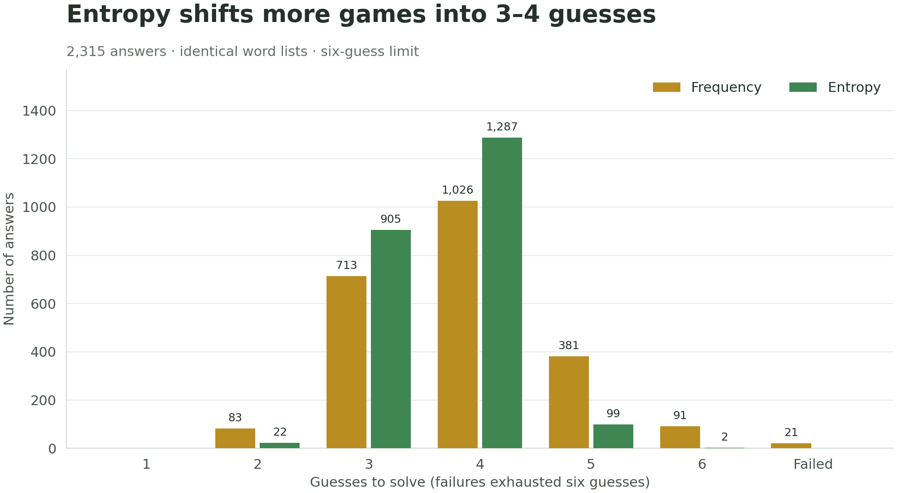
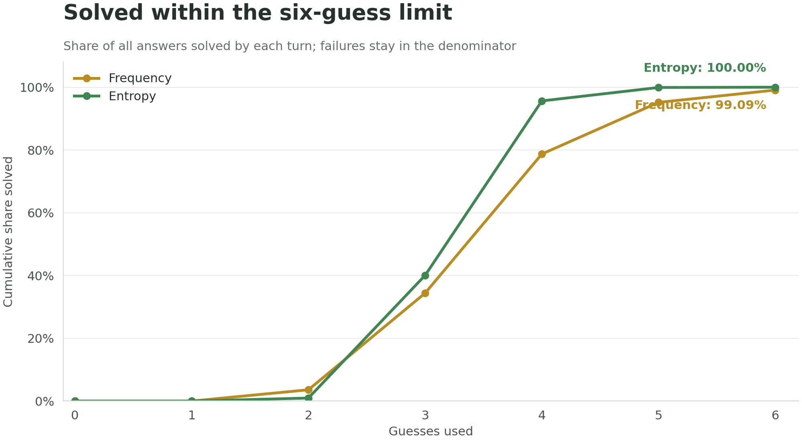

# Wordle Bot

**A terminal Wordle assistant written in C++20, built from scratch to learn modern C++.**

Enter your guesses and Wordle's feedback to narrow the possible answers and get a frequency- or entropy-based suggestion for your next move. The solver handles repeated letters, preserves previous constraints, and can suggest words outside the remaining answer set.

**C++20 · Standard library only · Terminal interface**

## Quick start

Requires a C++20-capable compiler. Developed with GCC 13.2.0 from MSYS2 on Windows, using VS Code and PowerShell.

From the repository root:

```powershell
g++ -std=c++20 -O2 -Wall -Wextra -Wpedantic main.cpp wordle.cpp -o wordlebot.exe
.\wordlebot.exe
```

Run from the repository root so the program can find the `data/` directory. Both `.cpp` files must be passed to the compiler; the header supplies declarations, while `wordle.cpp` supplies their definitions.

## Using the assistant

1. Select frequency (`f`) or entropy (`e`) at startup, then play the suggested word in Wordle or choose your own guess.
2. Enter the word you actually played.
3. Enter five feedback characters, from left to right:

| Character | Colour | Meaning |
| :---: | --- | --- |
| `g` | Green | Correct letter and position |
| `y` | Yellow | Correct letter, different position |
| `b` | Grey | No unused occurrence of that letter in the answer |

```text
Remaining answers: 2315
Frequency suggestion: oater
Enter guess (5 lowercase letters): oater
Enter feedback (g/y/b): bbyyy

Remaining answers: 24
Frequency suggestion: trice
```

Guesses must contain exactly five lowercase English letters. Feedback must contain exactly five characters drawn from `g`, `y`, and `b`.

If feedback leaves no matching answers, the assistant reports the problem and preserves the previous candidate set so you can retry. All-green feedback for a remaining answer ends the session. End-of-input also exits the program.

## How it works

### Reproducing Wordle feedback

The solver compares a guess against a candidate answer in two passes:

1. Mark greens and count the answer letters left unmatched.
2. Mark yellows only when an unused matching letter remains, consuming one occurrence each time.

Reserving greens first prevents duplicate letters from receiving too many yellow marks. For example, `allee` against `apple` produces `gybbg`.

### Filtering possible answers

For each candidate, generate the feedback that the submitted guess would produce. Keep the candidate only if that feedback exactly matches the user's observation.

Each round filters the surviving candidates from the previous round, retaining the constraints from the whole game.

### Choosing a guess

For every letter, count how many remaining answers contain it. Each answer contributes at most once per letter. A guess's score is the sum of these counts across its distinct letters:

```text
score(guess) = sum of candidate frequencies for each distinct letter in guess
```

The highest-scoring available word is suggested.

Entropy instead generates feedback for a guess against every remaining answer, grouping answers by feedback pattern. Assuming equally likely answers, a group containing a fraction `p` of the candidates contributes `-p * log2(p)` to the score. Summing those contributions measures expected information gain in bits. The highest-entropy guess is selected.

Both strategies keep the first word in list order when scores tie. Accepted guesses are removed from the suggestion pool; when only one candidate remains, that answer is suggested directly. Entropy measures information gained in the next turn; it does not directly optimise the total number of guesses to solve.

The two word pools serve different purposes:

| Pool | Role |
| --- | --- |
| Remaining answers | Used to calculate frequencies and track possible solutions |
| Available guesses | Words considered for suggestions, including words outside the remaining answers |

## Example result

The assistant solved a live puzzle with answer **WREST** in four guesses. An automated check reproduces the four-guess result with the bundled lists:

| Turn | Guess | Feedback | Answers remaining |
| :---: | --- | :---: | ---: |
| 1 | `oater` | `bbyyy` | 24 |
| 2 | `trice` | `ygbby` | 2 |
| 3 | `erupt` | `ygbbg` | 1 |
| 4 | `wrest` | `ggggg` | Solved |

This is one worked example. Aggregate results for the full answer set are below.

## Strategy comparison

Both strategies were evaluated against every answer in the bundled list, using a fresh candidate and guess pool for each game and a six-guess limit. Each started with 2,315 answers and 12,953 guess entries.

| Metric | Frequency | Entropy |
| --- | ---: | ---: |
| Solved within six guesses | 2,294 | 2,315 |
| Failures | 21 | 0 |
| Success rate | 99.093% | 100.000% |
| Average guesses among successes | 3.862 | 3.635 |

**Failures are excluded from each average.** Each failed game used all six guesses without solving. The averages therefore cover different successful subsets: 2,294 answers for frequency and all 2,315 for entropy. These results describe this fixed dataset and the current implementation, not a guarantee for live puzzles.





### Reproduce the benchmark

```powershell
g++ -std=c++20 -O2 -Wall -Wextra -Wpedantic benchmark.cpp wordle.cpp -o benchmark.exe
.\benchmark.exe
```

The runner loads the lists once, generates its own feedback, and writes [results/frequency.csv](results/frequency.csv) and [results/entropy.csv](results/entropy.csv), each with one row per answer. Failed games have `solved=false` and a blank `guesses` field. Failures are also listed in the terminal. Each run overwrites these two CSVs. The original [benchmark-results.csv](benchmark-results.csv) is retained as the earlier frequency baseline.

It shares the assistant's solver functions, removes used guesses, and uses the same list-order tie-breaking and single-candidate shortcut. Assertions check immediate success, the known frequency result for `wrest`, preservation of the true answer while filtering, and agreement between shared and fresh caches on a small answer set.

To avoid recalculating the same opening thousands of times, the benchmark caches suggestions by the complete guess/feedback history, with a separate cache for each strategy. For fixed lists and deterministic choices, the same history implies the same candidates and available guesses. The cache changes neither the selected guesses nor game outcomes; frequency results match the original uncached baseline row for row.

`-O2` enables compiler optimisation. The runner reports elapsed time for each strategy, including game simulation, cache lookups, and CSV writes but excluding loading and preliminary checks. **These are cached benchmark runtimes, not independent-game or interactive suggestion latencies.** Timing depends on the machine and build. The interactive assistant does not use this benchmark cache. `benchmark.cpp` and `main.cpp` are separate entry points, so build them as separate executables.

### Regenerate the figures

The figures are generated directly from the two result CSVs using Python and Matplotlib. These tools are only needed to regenerate the images; the C++ solver has no external dependencies.

```powershell
python -m pip install matplotlib
python scripts/plot_benchmarks.py
```

The script verifies that both CSVs contain the same ordered answer set and writes PNGs to `docs/images/`.

## Project structure

```text
main.cpp             Interactive terminal assistant
wordle.h             Shared function declarations
wordle.cpp           Loading, validation, feedback, filtering, and scoring
benchmark.cpp        Full-answer-set comparison of both strategies
benchmark-results.csv Original frequency baseline
results/
  frequency.csv      Latest per-answer frequency results
  entropy.csv        Latest per-answer entropy results
scripts/
  plot_benchmarks.py  Reproducible Matplotlib figures
docs/images/         Generated README charts
data/
  nyt-answers.txt     Initial possible-answer list
  nyt-guesses.txt     Additional guess-only words
  LICENSE            Word-list source's MIT licence
word.txt             Small development word list
```

## Word-list source

The bundled lists come from [Josh Stephenson's Wordle-Solver](https://github.com/joshstephenson/Wordle-Solver):

- [`nyt-answers.txt`](https://github.com/joshstephenson/Wordle-Solver/blob/main/nyt-answers.txt): 2,315 possible answers.
- [`nyt-guesses.txt`](https://github.com/joshstephenson/Wordle-Solver/blob/main/nyt-guesses.txt): 10,638 additional guesses in the local copy.

The program combines both files into an initial pool of 12,953 guess entries, while only the answer file supplies possible solutions. The source repository is published under the MIT licence; its copyright and licence notice are retained in [data/LICENSE](data/LICENSE).

These are fixed lists used for this project, not a guaranteed reflection of the current NYT answer and guess lists.

## Current limitations

- Letter frequency is a heuristic. It does not explicitly measure feedback partitions or expected information gain, and it does not guarantee a solution within six guesses.
- Entropy assumes equally likely remaining answers and recomputes feedback partitions for each considered guess. It is more expensive than letter-frequency scoring; full-dataset success does not guarantee success on a different word list.
- Suggestions can use obscure words from the allowed-guess list. Tie-breaking depends on file order.
- Guess input is checked for format, but is not checked for membership in the allowed-guess list.
- The interactive assistant trusts the user's feedback and has no independent access to the live answer. An empty result can indicate incorrect feedback or an answer missing from the dataset.
- The interactive assistant has no six-guess cap; the automated runner does.
- Benchmark assertions provide a few persistent checks; there is no separate regression test suite yet. Additional development checks have covered validation, duplicate-letter feedback, filtering, frequency counts, scoring, and tie-breaking.

## Next steps

- Keep repeatable regression tests alongside the solver.
- Measure interactive suggestion latency before deciding whether solver optimisation is needed.

## Learning goals

This project is an exercise in moving from C and Python to modern C++: standard-library containers, references and `const`, automatic resource management, separate compilation, and algorithm evaluation. It uses no external dependencies or manual memory allocation.
